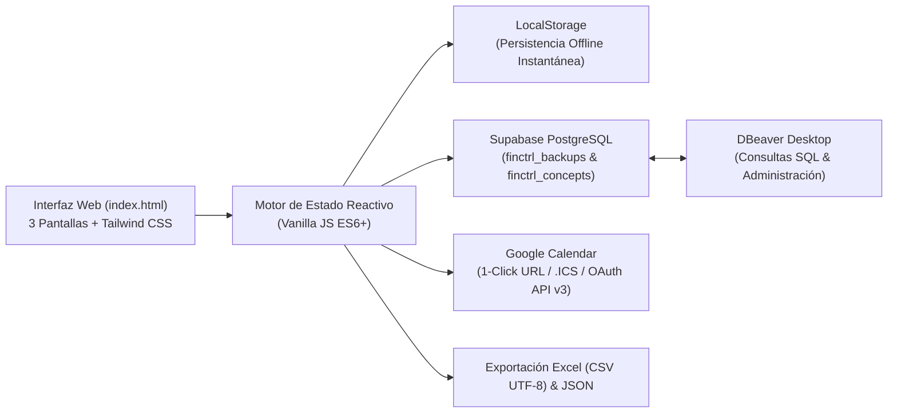

# 💳 FINCTRL — Dashboard Financiero Personal


**FINCTRL** es una aplicación web interactiva de **Control Presupuestal y Flujo de Nómina Personal**, diseñada como la evolución moderna, visual e intuitiva de una hoja de control de presupuesto en Excel.

Permite administrar ingresos basados en salario bruto o neto, dividir el flujo de efectivo por **semanas, quincenas o meses**, dar seguimiento al estatus real de cada pago (`[Pendiente]`, `[Apartado]`, `[Pagado]`), sincronizar recordatorios con **Google Calendar** y respaldar toda la información en la nube con **Supabase (PostgreSQL)**.

---

## ✨ Características y Función Principal

1. **Motor de Nómina e Ingresos (MXN)**:
   - Cálculo automático del **Salario Neto Mensual Aproximado** a partir del **Salario Bruto Mensual** de carta oferta (por defecto `$40,000 MXN`), con opción de ajuste manual si el recibo de nómina real varía.
   - Conversión dinámica e instantánea según la frecuencia de dispersión seleccionada: **Semanal (`S1–S4`)**, **Quincenal (`Q1–Q2`)** o **Mensual (`M1`)**.
2. **Descuento de Liquidez en Tiempo Real**:
   - Cuando un concepto cambia su estatus a **`[Pagado]`** o **`[Apartado]`**, el monto se descuenta automáticamente del **Saldo Disponible** de esa semana/periodo y del mes completo.
   - Regla configurable por el usuario: descontar **`[Pagado] + [Apartado]`** o **`Solo [Pagado]`**.
3. **Gestión Dinámica por Categorías y Subconceptos**:
   - Categorías predefinidas:
     - 🔴 **Gastos Fijos Obligatorios** *(Renta, Carro: Pago + Seguro, Servicios, Supermercado)*
     - 🔵 **Ahorro / Inversión** *(CETES, Fondo de Emergencia, ETFs)*
     - 🟣 **Gustos / Ocio** *(Restaurantes, Salidas, Suscripciones)*
     - 🟢 **Ingresos Extras** *(Bonos, Proyectos Freelance)*
     - 🟡 **Otros** *(Con campo dinámico para personalizar el nombre de la categoría)*
4. **Tema Adaptativo al Sistema Operativo**:
   - Soporte nativo para **Modo Claro / Modo Oscuro automático** (`prefers-color-scheme`) sincronizado con Windows/macOS, además de selector manual (`Auto`, `Claro`, `Oscuro`).
5. **Sincronización con Google Calendar**:
   - Agendado rápido en **1 clic** por concepto directo en Google Calendar Web.
   - Exportación de calendario mensual completo en formato universal **`.ics`**.
   - Sincronización directa mediante **Google Calendar API (OAuth 2.0)**.
6. **Persistencia Híbrida (Offline-First + Cloud)**:
   - Guardado instantáneo en **`localStorage`** para funcionar sin conexión ni configuración previa.
   - Conector integrado con **Supabase (PostgreSQL)** para auto-guardado en la nube y consulta desde **DBeaver**.

---

## 🖥️ Organización de la Interfaz (Arquitectura de 3 Pantallas)

Para evitar la saturación visual de las hojas de cálculo tradicionales, la interfaz está organizada en **3 pantallas enfocadas**:

| Pantalla | Nombre en la App | Propósito yComponentes Clave |
| :--- | :--- | :--- |
| **1. Vista General** | `Resumen` | • **4 Tarjetas KPI**: Ingresos Netos, Total Gastado/Apartado, Ahorro & Inversión, y Saldo Disponible.<br>• **Tarjetas de Liquidez por Periodo (`S1–S4`)**: Muestra cuánto dinero libre queda en cada semana (con clic rápido para abrir el detalle de esa semana).<br>• **Barras de Ejecución Presupuestal**: Progreso global multicapa y avance por categoría. |
| **2. Matriz de Control** | `Cronograma` | • **Tabla Interactiva por Periodos**: Edición en línea de nombres, montos y selectores de estatus (`Pendiente`, `Apartado`, `Pagado`).<br>• **Filtro de Enfoque por Semana (`[Todos \| S1 \| S2 \| S3 \| S4]`)**: Permite visualizar todo el mes o enfocar una sola semana a la vez.<br>• **Acciones Rápidas**: Botón `+ Añadir en [Categoría]` y botón `📅` para agendar en Google Calendar. |
| **3. Configuración** | `Nómina & Ajustes` | • **Calculadora de Salario Bruto/Neto** y selector de frecuencia (`Semanal`, `Quincenal`, `Mensual`).<br>• **Preferencias**: Regla de descuento y selector de tema visual.<br>• **Exportación y Conectividad**: Exportación a Excel (`CSV`), respaldo `JSON`, conexión con **Supabase** y **Google Calendar API**. |

---

## 🏗️ Estructura y Arquitectura del Proyecto

```text
finanzas-dashboard/
├── index.html            # Aplicación SPA autocontenida (UI, Motor de Estado, Supabase SDK y Google Calendar)
├── supabase_schema.sql   # Script DDL PostgreSQL (Tablas, Primary Keys y políticas RLS para Supabase / DBeaver)
└── README.md             # Documentación general, arquitectura y roadmap del proyecto
```

### Flujo de Datos y Arquitectura Técnica



---

## ⚙️ Información Técnica

### Stack Tecnológico
- **Frontend & UI**: HTML5 semántico + **Tailwind CSS** (vía CDN con configuración `darkMode: 'class'`) + tipografías `Inter` y `JetBrains Mono` (para cifras financieras alineadas).
- **Iconografía**: **Lucide Icons** renderizados dinámicamente.
- **Lógica de Aplicación**: **JavaScript Moderno (ES6+)** sin dependencias pesadas de compilación (Zero-Build Architecture), permitiendo ejecutar el proyecto con doble clic o servirlo en GitHub Pages.
- **Base de Datos Cloud**: **Supabase JS SDK v2** (`@supabase/supabase-js@2`) sobre **PostgreSQL 15+**.
- **Integración de Calendario**: Estándar **iCalendar (RFC 5545 `.ics`)**, plantillas URL de Google Calendar y **Google Identity Services (OAuth 2.0)** + **Google Calendar REST API v3**.

### Modelo de Base de Datos (`supabase_schema.sql`)
El esquema relacional en PostgreSQL utiliza dos tablas complementarias:
1. **`public.finctrl_backups`**:
   - Guarda la instantánea completa del perfil (`gross_monthly`, `manual_net_monthly`, `frequency`, `discount_rule` y el objeto `months_data` en formato `JSONB`) para sincronización atómica entre dispositivos.
2. **`public.finctrl_concepts`**:
   - Tabla normalizada por concepto y mes (`profile_key`, `month_key`, `id`, `category`, `name`, `flow_type`, `s1_amount`, `s1_status` ... `s4_amount`, `s4_status`), diseñada específicamente para consultar y auditar gastos desde **DBeaver** con SQL estándar.

---

## 🚀 Cómo Ejecutar y Configurar el Proyecto

### 1. Uso Local Inmediato
No requiere instalación de Node.js ni compiladores:
```bash
git clone https://github.com/dial999/finanzas-dashboard.git
```
Abre el archivo `index.html` directamente en cualquier navegador moderno (Chrome, Edge, Brave, Firefox, Safari).

### 2. Conexión con Supabase y DBeaver (Pendiente / En otra PC)
1. Crea un proyecto gratuito en [Supabase](https://supabase.com/dashboard).
2. Conecta **DBeaver** usando los datos de **Connect → Session Pooler (PostgreSQL)** de tu proyecto Supabase, o abre el **SQL Editor** web de Supabase.
3. Ejecuta el contenido íntegro de [`supabase_schema.sql`](./supabase_schema.sql) para crear las tablas y políticas RLS.
4. En el dashboard web (`Nómina & Ajustes` → `Base de Datos Supabase`), pega tu **Project URL** y tu **Anon Public Key** y haz clic en **"Conectar y Activar Auto-Guardado"**.

---

## 🗺️ Propósitos Futuros y Mejoras Pendientes (Roadmap)

### Corto Plazo (Fase 1 — Base de Datos y Despliegue)
- [ ] **Configurar instancia productiva en Supabase** desde la computadora principal y vincularla con **DBeaver**.
- [ ] **Activar GitHub Pages** en el repositorio para contar con una URL web accesible desde el celular o cualquier navegador.
- [ ] **Clonación de Plantilla Mensual**: Botón para copiar la lista de conceptos fijos de un mes al mes siguiente (reiniciando los estatus a `[Pendiente]`) con un solo clic.

### Mediano Plazo (Fase 2 — Autenticación y Automatización)
- [ ] **Autenticación con Cuenta de Google (Supabase Auth)**: Reemplazar la política RLS abierta de uso local por autenticación con correo/Google para proteger los datos con `auth.uid()`.
- [ ] **Fechas de Corte Exactas por Concepto**: Permitir asignar un día específico del mes a cada gasto fijo (ej. *Día 15: Seguro del Carro*) para recordatorios con hora y alarma personalizada en Google Calendar.
- [ ] **Actualización Bidireccional con Google Calendar**: Cuando un pago cambie a `[Pagado]` en el dashboard, actualizar automáticamente el título del evento existente en Google Calendar a `✅ PAGADO`.

### Largo Plazo (Fase 3 — Analítica e Inteligencia Artificial)
- [ ] **Asistente Financiero con Gemini API**: Chat integrado para registrar gastos o consultar métricas con lenguaje natural *(ej. "Aparté $1,400 del súper de la semana 2")*.
- [ ] **Comparativa Histórica Anual**: Gráficas de evolución de ahorro neto y gastos por categoría comparando mes contra mes.
- [ ] **Modo PWA (Progressive Web App)**: Agregar `manifest.json` y `Service Worker` para instalar el dashboard como aplicación nativa en iOS, Android y escritorio.

---

## 📄 Licencia

Este proyecto es de uso personal y código abierto bajo la licencia **MIT**.
